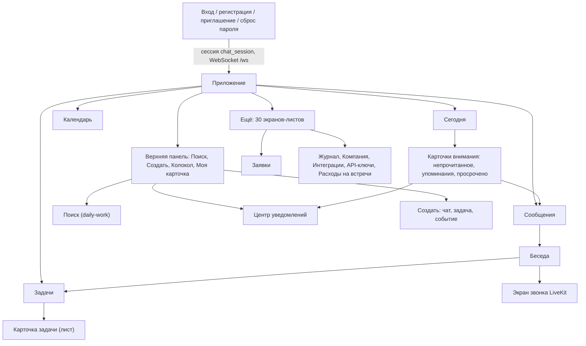
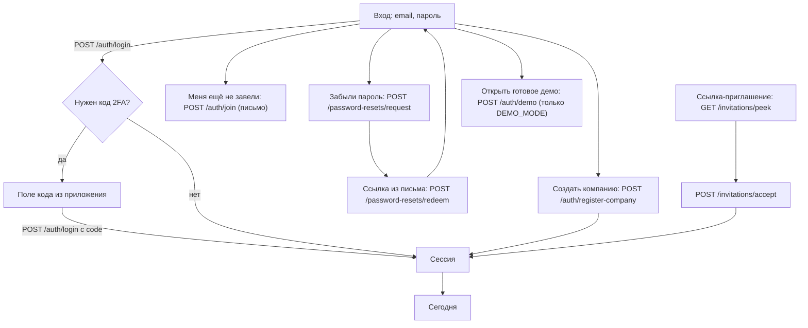
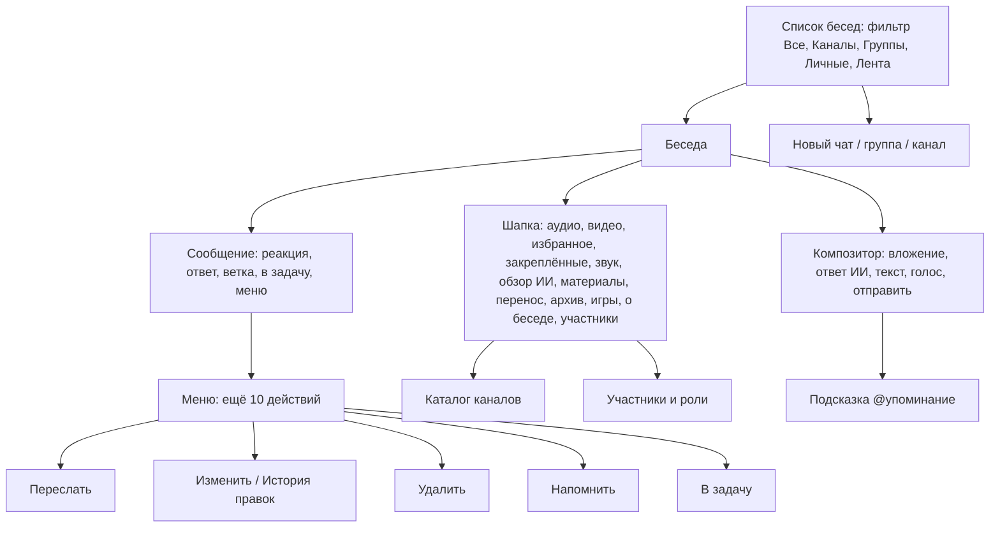
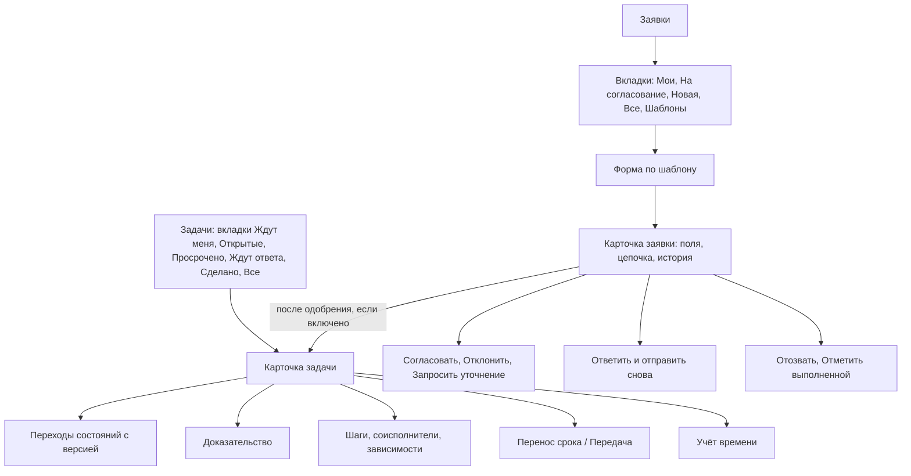
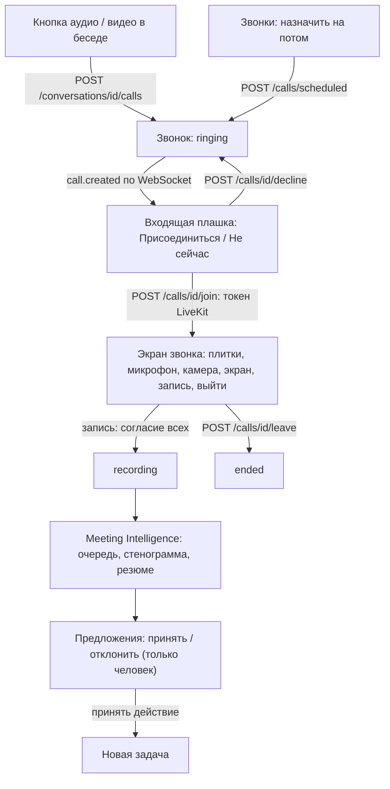
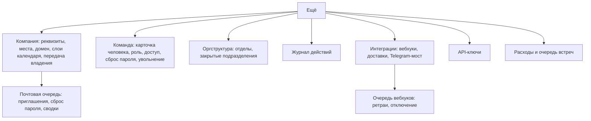
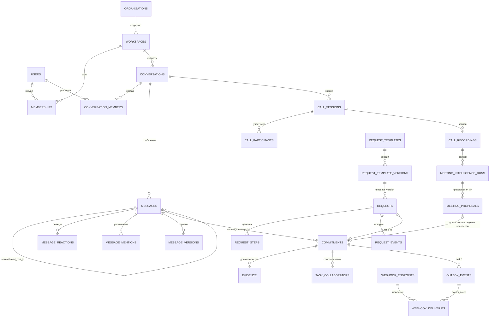
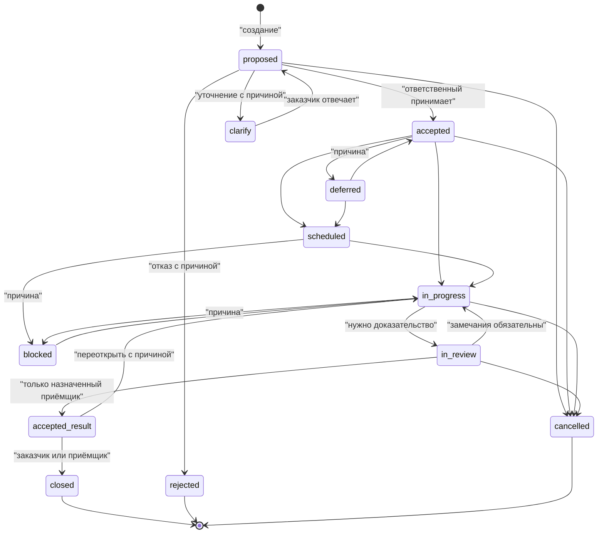
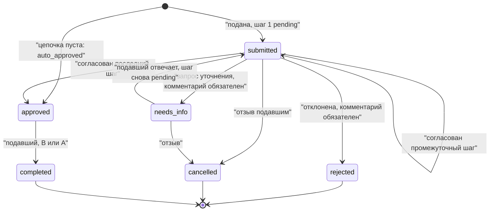
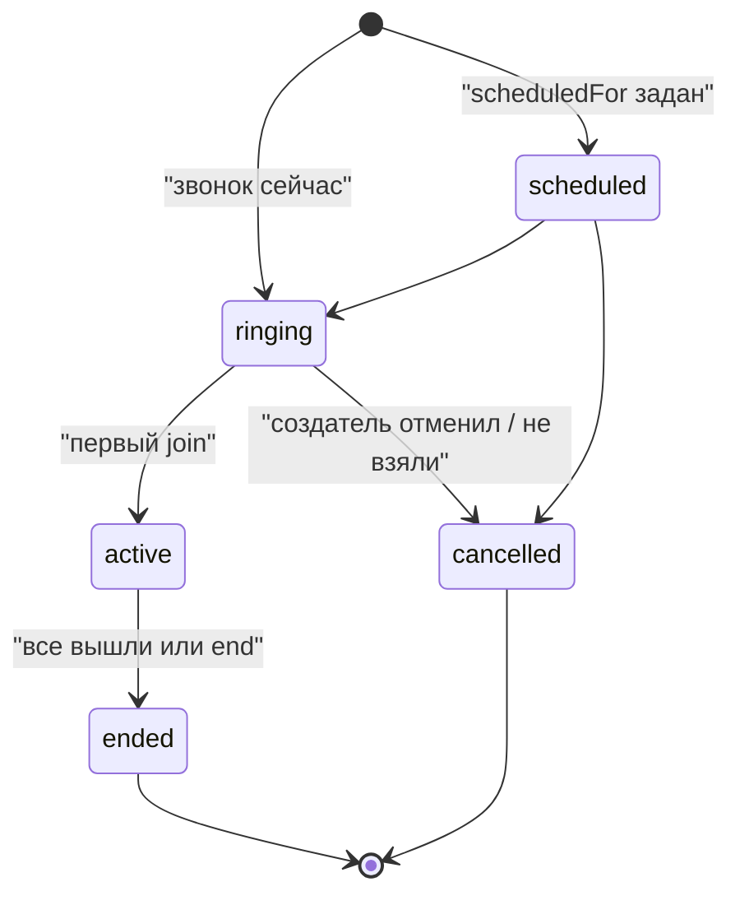

# ChatX: карта связей интерфейса

Дата: 2026-10-15. Источник фактов: чистый клон опубликованного `main` (70 миграций, 167 файлов тестов, `public/` 23 файла, `src/` 126 файлов). Локальная рабочая копия не использовалась. Пути указаны от корня репозитория; в `app.js` вместо строк даны имена функций и маршрутов (файл 6754 строки в одну-две тысячи символов на строку, номера строк ненадёжны). Аналитики (метрика, gtag и т.п.) в `public/` и `src/` не найдено: колонка «событие» содержит **предложение** по именованию `объект.действие`.

Сокращения источников: `A` = `public/app.js`, `D` = `public/daily-work.js`, `R` = `public/requests.js`, `C` = `public/calls-ui.js`, `M` = `public/meeting-intelligence.js`, `O` = `public/meeting-operations.js`, `P` = `public/preferences.js`, `H` = `src/http/`.

## 1. Карта экранов и переходов

Приложение одностраничное (`public/index.html`): два корневых контейнера (`#auth-view` для входа, `#app-view` для работы), пять разделов нижней навигации и около тридцати «листов» поверх них. Адрес-хеш: `#/today|chats|tasks|calendar|more`, `#/chats/<id>?message=<id>`, `#/tasks/<id>`, `#/calendar/<id>`, `#/more/<экран>`, `#/calls/<id>`, `#/meetings` (разбор в `A routeFromHash`, `C resumeHashCall`, `M`).

### 1.1 Общий обзор

### 1.2 Вход и учётная запись

### 1.3 Комнаты и сообщения

### 1.4 Задачи и заявки

### 1.5 Звонки и встречи

### 1.6 Администрирование и интеграции

## 2. Реестр действий

Роли: В = владелец, А = администратор, Р = руководитель, С = сотрудник, Г = гость; «все» = все авторизованные. Право берётся из `src/rbac.js`; если у права нет в роли, гость получает 404 (`requirePermission`), остальные 403. Идентификаторы сквозные: `AUT` вход, `NAV` навигация, `CHT` комнаты и сообщения, `TSK` задачи, `CAL` календарь, `REQ` заявки, `CLL` звонки, `MTG` встречи, `DLY` рабочий день, `SET` настройки, `ADM` администрирование, `INT` интеграции, `PER` личное. Префикс маршрута `/api/v1` опущен.

| ID | Экран | Элемент | Действие | Что происходит | Данные и API | Событие (предл.) | Кто может | Источник |
|---|---|---|---|---|---|---|---|---|
| AUT-01 | Вход | Форма «Войти в компанию» | отправить | Создаёт сессию (cookie `chat_session`, HttpOnly, 30 дней), открывает WebSocket, ведёт на «Сегодня» | `POST /auth/login`; троттлинг по адресу (20) и по почте (6) за 15 мин | `auth.login` | все | `A auth()`, `H auth.js`, `src/rate-limit.js` |
| AUT-02 | Вход | Поле «Код из приложения» | ввести код | Показывается, только когда сервер запросил TOTP | `POST /auth/login {code}` | `auth.two_factor_verify` | все | `index.html #login-code-row`, `H auth.js` |
| AUT-03 | Вход | Вкладка «Создать компанию» | отправить | Создаёт компанию и владельца; пароль от 12 знаков и цифра; реквизиты за раскрытием | `POST /auth/register-company` | `workspace.create` | аноним | `index.html #register-form`, `H auth.js` |
| AUT-04 | Вход | «Меня ещё не завели» | отправить почту | Если у компании объявлен домен и есть места, уходит письмо со ссылкой (через почтовую очередь) | `POST /auth/join` | `auth.join_request` | аноним | `A bindAuthExtras`, `H auth.js` |
| AUT-05 | Вход | «Забыли пароль?» | отправить почту | Письмо со ссылкой; ответ не раскрывает, есть ли адрес | `POST /password-resets/request` | `auth.reset_request` | аноним | `A forgotPasswordModal` |
| AUT-06 | Вход | Ссылка из письма | задать пароль | Сброс и вход | `POST /password-resets/redeem` | `auth.reset_done` | владелец ссылки | `A setAuth`, `H auth.js` |
| AUT-07 | Вход | Ссылка-приглашение | принять | Просмотр без траты (`peek`), затем создание аккаунта и сессии | `GET /invitations/peek`, `POST /invitations/accept` | `invitation.accept` | приглашённый | `A setAuth('invite')`, `H auth.js` |
| AUT-08 | Вход | «Открыть готовое демо» | нажать | Вход владельцем без пароля; кнопка есть только при `DEMO_MODE` | `POST /auth/demo` | `auth.demo_open` | аноним (если демо включено) | `public/demo.js`, `src/demo/preview-demo.js` |
| AUT-09 | Любой | Сессия истекла | автоматически | Тост «Сессия истекла», через 0,9 с экран входа; сокет закрыт кодом 4401 | любой 401 `UNAUTHENTICATED` | `auth.session_lost` | все | `A api()`, `src/server.js` watchdog |
| AUT-10 | Карточка | «Выйти» | нажать | Отзыв сессии, закрытие сокета | `POST /auth/logout` | `auth.logout` | все | `A logout()` |
| NAV-01 | Нижнее меню / сайдбар | Сегодня, Сообщения, Задачи, Календарь, Ещё | выбрать | Меняет `S.view` и хеш; у гостя «Задачи» и «Календарь» скрыты | `GET /bootstrap`, `/attention` | `nav.open` | все; Г без задач и календаря | `A nav`, `GUEST_HIDDEN_VIEWS` |
| NAV-02 | Верх | «Поиск» | открыть | Слой поиска по сообщениям, беседам, задачам, файлам, людям, событиям | `GET /search?q&type&from&to` (корзина heavy: 60/мин) | `search.open` | все (результаты по видимости) | `A actions.search`, `D openSearch`, `H daily-work.js` |
| NAV-03 | Верх | «Создать» (+) | открыть | Лист: новый чат, задача, событие | локально | `quick.open` | все; Г без задачи и события | `A quick()` |
| NAV-04 | Верх | Колокол | открыть | Центр уведомлений: все, упоминания; бейдж непрочитанного | `GET /notifications`, `/attention` | `notification.open` | все | `D ensureBell/openNotifications` |
| NAV-05 | Верх | Аватар | открыть | Карточка своего профиля (`personPage`) | `GET /people/{id}` | `profile.open` | все | `A actions.profile` |
| NAV-06 | Сайдбар | Профиль-карта | открыть | Настройки (`profileModal`): фото, пароль, 2FA, сессии, уведомления | см. SET | `settings.open` | все | `A shell()`, `profileModal` |
| NAV-07 | Сайдбар | «⌕» у «Каналы» | открыть | Каталог каналов компании | `GET /conversations/catalogue?q` | `channel.catalogue_open` | все | `A catalogueModal` |
| NAV-08 | Сайдбар | «＋» у «Каналы» | создать | Форма канала | `POST /conversations` kind=channel | `channel.create` | В, А, Р (`channel.create`) | `A channelModal`, `H messaging.js` |
| NAV-09 | Сайдбар | «＋» у «Личные» | выбрать человека | Создаёт или открывает личную беседу | `POST /conversations` kind=direct | `chat.direct_open` | все, кроме гостя | `A directModal` |
| NAV-10 | Адресная строка | Хеш `#/chats/<id>?message=<id>` | перейти | Открывает беседу и окно вокруг сообщения | `GET /conversations/{id}/messages?around=` | `link.open` | участник | `A routeFromHash/openChatAtMessage` |
| NAV-11 | Любой экран | Нет сети | показать | Экран «Нет связи», повтор при `online`; запись не ставится в очередь | `bootstrap()` | `app.offline` | все | `A offlineScreen` |
| DLY-01 | Сегодня | Карточки внимания | нажать | Непрочитанное ведёт в первую беседу с непрочитанным, упоминания в центр уведомлений | `GET /attention` | `attention.open` | все | `D ensureAttentionStrip` |
| DLY-02 | Сегодня | «Ждут вашего ответа» | открыть задачу | Список задач `clarify` и `proposed`; ответ прямо в строке | `POST /tasks/{id}/transitions` | `task.answer` | ответственный | `A answerNeededSection`, bind |
| DLY-03 | Сегодня | «План» | открыть | Личные дела и напоминания дня | `GET /personal-items` | `plan.open` | все | `A planSection` |
| DLY-04 | Уведомления | Строка | открыть | Помечает прочитанным и ведёт по `url` (беседа, задача, звонок, заявка, встреча) | `POST /notifications/{id}/read` | `notification.read` | получатель | `D`, `H daily-work.js` |
| DLY-05 | Уведомления | «Прочитать все» | нажать | Массовая отметка (в рамках фильтра) | `POST /notifications/read-all` | `notification.read_all` | получатель | `D data-dwc-read-all` |
| DLY-06 | Уведомления | Архив / «убрать прочитанные» | нажать | Переносит в архив | `POST /notifications/{id}/archive`, `/archive-read` | `notification.archive` | получатель | `D`, `H daily-work.js` |
| DLY-07 | Ещё | «Что я пропустил» | открыть | Сводка: упоминания, сроки, решения без вас | `GET /digest` (heavy) | `digest.open` | все | `A digestModal` |
| DLY-08 | Ещё | Файлы | открыть | Список всех доступных файлов, фильтр по типу | `GET /files?mime&q&cursor` | `files.open` | все | `D openFiles` |
| DLY-09 | Колокол | Настройки уведомлений | сохранить | Что присылать и тихие часы | `GET/PUT /notification-preferences` | `notification.prefs_save` | все | `A profileModal`, `H daily-work.js` |
| DLY-10 | Сегодня | Онбординг | закрыть | Скрывает подсказки | `GET /onboarding`, `POST /onboarding/dismiss` | `onboarding.dismiss` | все | `A onboardingSection` |
| CHT-01 | Сообщения | Фильтр Все/Каналы/Группы/Личные/Лента | выбрать | Фильтрует список; бейдж непрочитанного «99+» | локально; `GET /conversations` | `chat.filter` | все | `A CONVERSATION_GROUPS, countIn` |
| CHT-02 | Список бесед | Строка беседы | открыть | Загружает 100 сообщений, ставит границу «Непрочитанное», отмечает прочитанным при доходе до низа | `GET /conversations/{id}/messages`, `POST /conversations/{id}/read` | `chat.open` | участник | `A openChat/markConversationRead` |
| CHT-03 | Беседа | «Показать более ранние» | нажать | Подгрузка по курсору `before=<время>|<id>` | `GET .../messages?before=` | `chat.load_older` | участник | `A loadOlderMessages` |
| CHT-04 | Композитор | Поле, Enter | отправить текст | POST с ключом идемпотентности; при ошибке текст возвращается в поле; черновик хранится в `localStorage` | `POST /conversations/{id}/messages` (до 12000 знаков) | `message.send` | `message.send` (В, А, Р, С, Г) | `A send()`, `H messaging.js` |
| CHT-05 | Композитор | «＋» | прикрепить файл | Загрузка файла в хранилище, затем сообщение kind=file | `POST /files` (до 50 МБ, заголовок `x-file-name`), `POST .../messages` | `file.upload` | `file.upload`, `message.send` | `A #file-picker.onchange`, `H media.js` |
| CHT-06 | Композитор | «◖» | записать голос | MediaRecorder, повторное нажатие отправляет; 250 мс до 60 мин | `POST /conversations/{id}/voice?durationMs` | `voice.send` | `file.upload`, `message.send` | `A voice()`, `H media.js` |
| CHT-07 | Композитор | «@» в тексте | упомянуть | Подсказка людей, стрелки и Enter; при отправке уходят упомянутые и уведомление `message.mentioned` | `POST .../messages {mentionedUserIds}` | `mention.add` | участник | `D updateMentionPicker/chooseMention` |
| CHT-08 | Композитор | Звезда ИИ | предложить ответы | Варианты ответа; отправляет только человек | `POST /conversations/{id}/assistant/suggest-replies` | `assistant.suggest` | `ai.use` (не гость) | `A assistantSuggestModal`, `H chat-assistant.js` |
| CHT-09 | Беседа | Звезда ИИ в шапке | обзор беседы | Краткое резюме разговора | `POST .../assistant/summarize` | `assistant.summarize` | `ai.use` | `A assistantSummarizeModal` |
| CHT-10 | Сообщение | Ответить | выбрать | Блок «Ответ на», `replyToId` | `POST .../messages {replyToId}` | `message.reply` | участник | `A data-reply` |
| CHT-11 | Сообщение | Ветка (⤷) | открыть | Окно ветки, ответы внутри не попадают в ленту | `GET .../messages?thread=<id>`, `POST {threadRootId}` | `thread.open` | участник | `A threadModal` |
| CHT-12 | Сообщение | Реакция | поставить / снять | Эмодзи (проверка на стороне сервера) | `POST /messages/{id}/reactions` | `reaction.toggle` | участник | `A react`, `H messaging.js` |
| CHT-13 | Меню | Изменить | сохранить | Только своё текстовое непереслано; версия правки сохраняется | `PATCH /messages/{id}`; `GET /messages/{id}/versions` | `message.edit` | автор | `A editMessageModal, messageHistoryModal` |
| CHT-14 | Меню | Удалить | подтвердить | Тело заменяется на «Сообщение удалено» | `DELETE /messages/{id}` | `message.delete` | автор (`message.delete.own`) либо В, А (`message.delete.any`) | `A deleteMessageModal` |
| CHT-15 | Меню | Закрепить / Открепить | нажать | В личной беседе любой, в остальных управляющий | `POST/DELETE /messages/{id}/pin` | `message.pin` | управляющий беседой | `H messaging.js` |
| CHT-16 | Меню | Переслать | выбрать беседу | Копия с происхождением; в закрытое не раскрывает источник | `POST /messages/{id}/forward` | `message.forward` | `message.send` | `A forwardModal` |
| CHT-17 | Меню | В избранное | нажать | Личная отметка | `POST/DELETE /messages/{id}/save` | `message.save` | все | `A toggleSave` |
| CHT-18 | Меню | Выделить / Заметка | сохранить | Личные пометки (маркер со смещениями, заметка) | `POST/DELETE /highlights`, `/message-notes`, `/favourites/{type}/{id}` (marks) | `mark.create` | автор пометки | `A highlightModal/noteModal`, `H marks.js` |
| CHT-19 | Меню | Напомнить | выбрать время | Личное напоминание на сообщение | `POST /reminders` | `reminder.create` | не гость | `A remindAboutModal` |
| CHT-20 | Меню | Метка | выбрать | Общая метка компании | `PUT /labels/{id}/links/message/{id}` | `label.apply` | не гость | `A labelPicker` |
| CHT-21 | Меню | Скопировать ссылку | нажать | Буфер обмена `.../#/chats/id?message=id` | локально | `message.copy_link` | все | `A messageMenu` |
| CHT-22 | Меню | В задачу | создать | Задача с `sourceMessageId`, чип на сообщении | `POST /tasks` | `task.from_message` | `task.create` (не Г) | `A quickTaskModal` |
| CHT-23 | Шапка | Звук | отключить на 8 ч / включить | Приглушение личное | `PATCH /conversations/{id}/preferences` | `chat.mute` | участник | `A toggleMute` |
| CHT-24 | Шапка | Архив | убрать в архив | Скрывает беседу только для вас | `POST /conversations/{id}/archive` | `chat.archive` | участник | `A archiveCurrent`, `archivedModal` |
| CHT-25 | Шапка | Закреплённые | открыть | Список закреплённых | `GET /conversations/{id}/pins` | `pins.open` | участник | `A pinsModal` |
| CHT-26 | Шапка | Участники | открыть | Состав, роли owner/moderator/member/guest, добавить, убрать | `GET/POST /conversations/{id}/members`, `PATCH/DELETE .../members/{userId}` | `chat.member_change` | управляющий (В, А, Р или owner/moderator) | `A membersModal`, `H messaging.js` |
| CHT-27 | Шапка | О беседе | изменить | Название, описание, фото, «только объявления», выход, взять канал | `PATCH /conversations/{id}` (`expectedVersion`), `POST .../leave`, `.../claim` | `chat.edit` | управляющий; выход любой | `A conversationModal/conversationEditModal` |
| CHT-28 | Шапка | Материалы | открыть | Фото, видео, ссылки, переносы | `GET /conversations/{id}/archive` и поиск | `chat.materials_open` | участник | `A materialsModal` |
| CHT-29 | Шапка | Перенос из мессенджера | вставить текст | Импорт сообщений с отметкой «Из WhatsApp/Telegram» | `POST /conversations/{id}/external-forwards` | `chat.import` | `message.send` | `A importModal`, `src/messaging/external-forward.js` |
| CHT-30 | Каталог | Строка канала | присоединиться | Вступление в открытый канал | `POST /conversations/{id}/join` | `channel.join` | не гость | `A catalogueModal` |
| CHT-31 | Новая группа | Форма | создать | Группа от двух человек | `POST /conversations` kind=group | `group.create` | `message.send` (если вся компания, то `channel.create`) | `A groupModal` |
| CHT-32 | Ещё | Избранное | открыть | Беседы, сообщения, задачи, выделения, заметки | `GET /favourites?type=`, `/saved-messages`, `/highlights`, `/message-notes` | `favourites.open` | все | `A favouritesModal` |
| CHT-33 | Шапка | Игры | начать | Шахматы, шашки, морской бой | `GET/POST /games`, `/games/{id}/moves` | `game.start` | не гость | `A gamesModal` |
| CHT-34 | Истории | Опубликовать / смотреть | нажать | Короткие истории команды | `GET/POST /stories`, `/stories/{id}/seen` | `story.publish` | не гость (рассылка `story.published` скрыта от гостя) | `A storiesModal`, `src/realtime.js` |
| TSK-01 | Задачи | Вкладки | выбрать | Серверная выборка по состоянию, курсор страницы | `GET /tasks?limit&cursor`, `/tasks/report` | `task.filter` | не гость | `A tasks(), loadTaskPage` |
| TSK-02 | Задачи | «Новая задача» | создать | Название, результат, ответственный, приёмщик, срок, важность | `POST /tasks` | `task.create` | `task.create` (В, А, Р, С) | `A taskModal` |
| TSK-03 | Задача | Принять ответственность | нажать | proposed → accepted, только ответственный | `POST /tasks/{id}/transitions {to,expectedVersion}` | `task.accept` | ответственный | `src/task/task-authority.js` |
| TSK-04 | Задача | Отказаться / Уточнить | написать причину | proposed → rejected / clarify; без причины 400 | то же | `task.reject` | ответственный | `task-authority.js REASON_REQUIRED` |
| TSK-05 | Задача | Запланировать / Начать | нажать | accepted → scheduled → in_progress | то же | `task.start` | ответственный | `taskActionLabel` |
| TSK-06 | Задача | Доказательство | добавить | Текст, ссылка или файл; без него «На проверку» недоступна | `POST /tasks/{id}/evidence` | `task.evidence_add` | ответственный, заказчик, приёмщик, руководитель | `A #task-evidence-form` |
| TSK-07 | Задача | На проверку | нажать | in_progress → in_review (нужно ≥1 доказательства) | transitions | `task.submit_review` | ответственный | `task-authority.js` |
| TSK-08 | Задача | Принять результат / Вернуть | нажать | in_review → accepted_result или назад с замечаниями | transitions | `task.accept_result` | только назначенный приёмщик | `task-authority.js` |
| TSK-09 | Задача | Закрыть | нажать | accepted_result → closed | transitions | `task.close` | заказчик или приёмщик | там же |
| TSK-10 | Задача | Отменить / Отложить / Блокировка | написать причину | Любая стадия до закрытия; причина обязательна | transitions | `task.cancel` | отменить: ответственный, заказчик, руководитель | там же |
| TSK-11 | Задача | Перенести срок | сохранить | Причина обязательна, версия растёт | `PATCH /tasks/{id}/schedule` | `task.reschedule` | ответственный, заказчик, руководитель | `A taskRescheduleModal` |
| TSK-12 | Задача | Передать другому | выбрать | Новый ответственный возвращает задачу в proposed | `POST /tasks/{id}/assignment` | `task.reassign` | заказчик или руководитель (не ответственный) | `A taskReassignModal` |
| TSK-13 | Задача | Шаги, соисполнители, зависимости | добавить / отметить | Внутренности обязательства; у закрытых не правятся | `/tasks/{id}/checklist`, `/collaborators`, `/dependencies` | `task.structure_edit` | ответственный, заказчик, приёмщик, руководитель | `A taskStructureSection` |
| TSK-14 | Задача | Учёт времени | старт / стоп | Таймер задачи | `POST /tasks/{id}/time-entries/start`, `POST /time-entries/{id}/stop` | `time.start` | не гость | `A renderTaskTimeSlot`, `H time-tracking.js` |
| TSK-15 | Задача | Напомнить, Метка | открыть | Личное напоминание; метка | `/reminders`, `/labels` | `task.remind` | не гость | `A taskDetailModal` |
| TSK-16 | Ещё | Отчёт по обязательствам | открыть | Кто держит слово, перегруз | `GET /tasks/report` | `report.open` | не гость; чужое: `task.manage.team` | `A reportModal` |
| TSK-17 | Ещё | Отчёт по времени, Дашборд | открыть | Часы и тренд | `/time-entries`, `/dashboard` | `dashboard.open` | не гость | `A timeReportModal/dashboardModal` |
| CAL-01 | Календарь | Неделя / день | листать | Загружает диапазон | `GET /calendar-events?from&to` | `calendar.view` | не гость | `A calendar()`, `loadCalendarRange` |
| CAL-02 | Календарь | «Новое событие» | сохранить | Встреча, повтор, участники, комната звонка | `POST /calendar-events` | `event.create` | `calendar.create` (не Г) | `A eventModal` |
| CAL-03 | Календарь | Карточка события | ответить | Принять / отклонить | `POST /calendar-events/{id}/respond` | `event.rsvp` | приглашённый | `A eventPage`, `H calendar.js` |
| CAL-04 | Календарь | Протокол встречи | сохранить | Заметки встречи, фиксация решений | `/calendar-events/{id}/notes`, `/notes/commit` | `event.notes_save` | участник | `A notesModal` |
| CAL-05 | Календарь | Подписка ICS | скопировать | Ссылка-фид только для чтения | `GET/POST /calendar/ics` (выдаёт токен), публичный фид `GET /calendar/ics/{token}` | `calendar.subscribe` | не гость | `A calendarSubscribeModal` |
| REQ-01 | Заявки | Вкладка «Новая» | выбрать шаблон | Форма по полям версии шаблона | `GET /request-templates` | `request.template_pick` | не гость (Г: 404) | `R newRequest` |
| REQ-02 | Заявки | «Отправить заявку» | отправить | Проверка значений, шаги по порогу суммы, при пустой цепочке авто-одобрение | `POST /requests {templateId,values}` | `request.submit` | С, Р, А, В | `R form`, `src/requests/request-repository.js submit` |
| REQ-03 | Заявка | Согласовать | нажать | Шаг одобрен; последний шаг переводит в approved; пропускаются шаги без согласующих | `POST /requests/{id}/decision {decision:approve}` | `request.approve_step` | согласующий по роли/человеку, не подавший | `R detail`, repo `decide` |
| REQ-04 | Заявка | Отклонить | написать причину | status rejected | decision reject | `request.reject` | согласующий | то же |
| REQ-05 | Заявка | Запросить уточнение | написать вопрос | status needs_info, подавшему уведомление | decision needs_info | `request.ask_info` | согласующий | то же |
| REQ-06 | Заявка | Ответить и отправить снова | править поля | needs_info → submitted, текущий шаг снова pending | `POST /requests/{id}/respond` | `request.respond` | подавший | `R data-rq-respond` |
| REQ-07 | Заявка | Отозвать | нажать | submitted/needs_info → cancelled | `POST /requests/{id}/cancel` | `request.cancel` | подавший | repo `cancel` |
| REQ-08 | Заявка | Отметить выполненной | нажать | approved → completed | `POST /requests/{id}/complete` | `request.complete` | подавший, В, А | repo `complete` |
| REQ-09 | Заявка | Открыть задачу | нажать | Переход в карточку заведённой задачи | `ChatApp.openTask` | `request.open_task` | видящий задачу | `R data-rq-task` |
| REQ-10 | Шаблоны | Создать из образца / свой | создать | Образцы: Отпуск, Покупка (порог 100000 для админа), Доступ; свой шаблон строкой `ключ \| подпись \| тип \| *` | `POST /request-templates` | `template.create` | `member.manage` (В, А) | `R STARTERS, templatesScreen` |
| REQ-11 | Шаблоны | Архивировать | нажать | Новые заявки по нему не принимаются | `POST /request-templates/{id}/archive` | `template.archive` | В, А | `R` |
| REQ-12 | Заявки | Вкладки «Все», «Шаблоны» | открыть | Очередь, средние сроки | `GET /requests?scope=all`, `/requests/queue` | `request.queue_open` | В, А | `R refreshTabs` |
| CLL-01 | Беседа | Кнопки аудио / видео | нажать | Создаёт звонок (минимум 2 участника), открывает экран, ждёт токен LiveKit | `POST /conversations/{id}/calls`, `POST /calls/{id}/join` | `call.start` | `call.start` (все роли, в т.ч. Г) | `C startOutgoing`, `H calls.js` |
| CLL-02 | Входящий звонок | «Присоединиться» | нажать | `join`, подключение к LiveKit | `POST /calls/{id}/join` | `call.join` | приглашённый | `C incomingCall` |
| CLL-03 | Входящий звонок | «Не сейчас» | нажать | Плашка исчезает, отказ уходит звонящему | `POST /calls/{id}/decline` | `call.decline` | приглашённый | `C incomingCall` |
| CLL-04 | Звонок | Микрофон / камера / экран | переключить | Меняет треки LiveKit и состояние участника | `PATCH /calls/{id}/media` | `call.media_toggle` | участник | `C control` |
| CLL-05 | Звонок | «●» запись | дать согласие | Запись стартует только когда согласны все активные; иначе ждёт | `POST /calls/{id}/recording-consent`, `.../recording/start|stop` | `call.record_consent` | старт/стоп: В, А, Р (`call.record`) | `C control`, `H calls.js` |
| CLL-06 | Звонок | «×» | выйти | Отключает комнату, уведомляет сервер | `POST /calls/{id}/leave` (также `sendBeacon` при закрытии вкладки) | `call.leave` | участник | `C leave` |
| CLL-07 | Ещё | Звонки | назначить | Звонок на потом из списка участников беседы | `GET/POST /calls/scheduled`, `POST /calls/{id}/cancel` | `call.schedule` | `call.start`; отмена: создатель | `A callsModal` |
| CLL-08 | Адрес | `#/calls/<id>` | открыть | Автоматически присоединяется после входа | `GET /calls/{id}`, `join` | `call.deeplink` | приглашённый | `C resumeHashCall` |
| MTG-01 | Встречи | Список / карточка | открыть | Статусы обработки, стенограмма, резюме, решения | `GET /calls/{id}/meeting`, `GET /meetings` | `meeting.open` | участник звонка | `M openMeeting` |
| MTG-02 | Карточка встречи | Принять предложение | подтвердить | Действие превращается в задачу по решению человека | `POST /meeting-proposals/{id}/accept` | `proposal.accept` | `ai.use` (+`task.create` для действий) | `M acceptProposal`, `H meeting-intelligence.js` |
| MTG-03 | Карточка встречи | Отклонить | нажать | proposed → rejected | `POST /meeting-proposals/{id}/reject` | `proposal.reject` | `ai.use` | `M rejectProposal` |
| MTG-04 | Ещё | Решения компании | поиск | Сквозной список решений | `GET /meetings/decisions?q&from&to` | `decisions.open` | участник встреч | `A decisionsModal` |
| MTG-05 | Ещё | Очередь обработки | повторить / отменить | Просмотр упавших задач, причина обязательна | `GET /admin/meeting-jobs`, `POST .../retry|cancel`, `GET .../audit` | `mjob.retry` | `meeting.ops.manage` (В, А) | `O`, `H meeting-operations.js` |
| MTG-06 | Ещё | Расходы на встречи | смотреть, задать тариф | Версионные тарифы провайдера | `GET /admin/meeting-costs`, `GET/POST /admin/meeting-prices` | `mprice.create` | `meeting.cost.read/manage` (В, А) | `O` |
| PER-01 | Ещё | План | создать | Личные дела, срок, комментарии, файлы | `/personal-items…` | `plan.create` | не гость | `A planModal, planItemPage` |
| PER-02 | Ещё | Напоминания | создать | Личное напоминание; воркер будит в срок | `/reminders` | `reminder.create` | не гость | `A remindersModal` |
| PER-03 | Ещё | Хранилище паролей | добавить / показать | Показ пароля — отдельный запрос с записью в журнал | `/vault`, `POST /vault/{id}/secret` | `vault.reveal` | `vault.use` (не Г); не по API-ключу | `A vaultModal`, `H vault.js` |
| PER-04 | Ещё | Контакты | открыть | Справочник людей | `GET /people`, `/contacts` | `contacts.open` | не гость | `A contactsModal` |
| PER-05 | Ещё | Мой статус | выбрать | online/away/busy/do_not_disturb; приглушает плашку звонка | `POST /presence` | `presence.set` | все | `A presenceModal` |
| PER-06 | Ещё | Метки | создать | Общий словарь компании | `/labels` | `label.create` | не гость | `A labelsModal` |
| PER-07 | Ещё | База знаний | читать / писать | Статьи; писать — В, А, Р | `/knowledge` | `knowledge.open` | чтение все сотрудники; запись `knowledge.manage` | `A knowledgeModal` |
| PER-08 | Ещё | Вики | читать / писать | Страницы с версиями и `expectedVersion` | `/wiki/pages` | `wiki.edit` | `wiki.use` (не Г) | `A wikiModal` |
| SET-01 | Настройки | Фото | загрузить | Только jpeg/png/webp/gif/avif до 8 МБ, не SVG | `POST /files`, `PATCH /people/{id}` | `profile.avatar_set` | свой профиль | `src/media/avatar.js`, `A uploadPicture` |
| SET-02 | Настройки | Пароль | сменить | Пароль от 12 знаков, цифра | `POST /auth/password` | `auth.password_change` | сессия, не API-ключ | `A profileModal` |
| SET-03 | Настройки | Второй множитель | включить | TOTP + коды восстановления | `/auth/two-factor`, `/confirm`, `/recovery-codes` | `auth.two_factor_enable` | сессия | `A twoFactorSetupModal` |
| SET-04 | Настройки | Где вы вошли | завершить | Отзыв устройства или всех остальных | `GET /auth/sessions`, `POST .../revoke-others`, `DELETE .../{id}` | `auth.session_revoke` | сессия | `A profileModal` |
| SET-05 | Настройки | Тема и язык | выбрать | Чёрная / Белая, RU / EN, в `localStorage` (`chat.theme`, `chat.locale`) на устройстве | локально | `settings.theme_change` | все | `P preferenceControls`, `public/theme-boot.js` |
| SET-06 | Настройки | Push | включить | Подписка браузера | `POST /push-subscriptions` | `push.subscribe` | `push.subscribe` (все роли) | `A enablePush`, `H media.js` |
| ADM-01 | Ещё | Компания | сохранить | Реквизиты, места, домен, слои календаря; имя и передача только В | `PATCH /workspace`, `POST /workspace/owner` | `workspace.update` | `organization.settings` (В, А); имя/владение В | `H workspace-settings.js` |
| ADM-02 | Ещё | Команда | открыть карточку | Роль, доступ до даты, увольнение и возврат, сброс пароля | `PATCH /people/{id}`, `PUT /people/{id}/access`, `/role`, `/deactivate`, `/reactivate`, `POST /password-resets` | `member.update` | `member.manage` (В, А) | `A personPage, issueResetModal` |
| ADM-03 | Ещё | Пригласить | отправить | Письмо через очередь; массовое по списку | `POST /invitations`, `/invitations/bulk`, `/resend`, `DELETE` | `invitation.send` | `member.invite` (В, А, Р) | `A inviteModal, bulkInviteModal` |
| ADM-04 | Ещё | Оргструктура | править | Отделы, закрытые подразделения, цепочка руководителей | `/org/units…` | `org.unit_change` | `org.structure.manage` (В, А); закрытое также Р | `A orgModal`, `H org.js` |
| ADM-05 | Ещё | Журнал | смотреть | Приглашения, входы, раскрытие паролей | `GET /audit` | `audit.open` | `audit.read` (В, А, Р) | `A journalModal`, `H audit.js` |
| ADM-06 | Ещё | Экспорт пространства | скачать | Архив всего пространства (3 запроса/мин на человека) | `GET /export` | `export.download` | только В (`organization.manage`) | `H export.js`, `src/rate-limit.js` |
| INT-01 | Интеграции | Подписка вебхука | создать | Адрес и темы; секрет показывается один раз; подпись HMAC | `POST /integrations/webhooks` | `webhook.create` | `integration.manage` (В, А) | `A endpointFormModal` |
| INT-02 | Интеграции | Журнал доставок | смотреть | Статусы pending, delivering, delivered, failed, dead | `GET /integrations/deliveries` | `webhook.deliveries_open` | В, А | `A integrationsModal` |
| INT-03 | Интеграции | Включить / выключить / удалить | нажать | Автоотключение после серии сбоев | `POST /integrations/webhooks/{id}/enable|disable`, `DELETE` | `webhook.toggle` | В, А | `H integrations.js` |
| INT-04 | Интеграции | Telegram-мост | привязать | Беседа ↔ чат Telegram; входящий вебхук проверяется секретом | `/integrations/telegram` | `telegram.bridge` | В, А | `A telegramBridgeFormModal`, `H telegram.js` |
| INT-05 | API-ключи | Создать / отозвать | нажать | Ключ показывается один раз, права владельца, режим «только чтение» | `/api-keys` | `apikey.create` | не гость | `A apiKeyFormModal` |
| ERR-01 | Любой | Ответ 429 | показать | «Слишком много запросов»; `Retry-After` | любой запрос | `error.rate_limited` | все | `src/server.js` |
| ERR-02 | Любой | Нет связи при записи | повторить | Один автоповтор с тем же ключом, затем тост | `A api()` | `error.network` | все | `A api()` |
| ERR-03 | Гость | Закрытая функция | открыть | 404 «Not found»: не раскрывает существование | `requirePermission`, `isGuest` | `error.guest_hidden` | Г | `src/rbac.js`, `src/http/requests.js` |

Всего в реестре 141 строка (счёт по префиксам ID).

## 3. Модель данных

70 миграций (`db/migrations/001_core.sql` … `070_requests.sql`), PostgreSQL 17, около 100 таблиц. Миграция `034_drop_unbuilt_tables.sql` удалила `message_receipts`, `device_registrations`, `calendar_blocks`, `teams`, `team_members`, `projects`, `project_members`: то есть таблицы статусов доставки и чтения были задуманы и убраны (см. файл 08).

| Сущность | Таблица | Ключевые поля (без значений) | Связи |
|---|---|---|---|
| Организация, пространство | `organizations`, `workspaces` | id, название, реквизиты, лимит мест, домен входа | 1→N пространств; все таблицы несут `organization_id`, `workspace_id` |
| Пользователь, членство | `users`, `memberships`, `workspace_profiles`, `auth_credentials`, `user_sessions` | role (owner/admin/manager/member/guest), display_name, avatar_file_id, hash токена сессии | N↔N пользователь-пространство через `memberships` |
| Беседа | `conversations` | kind (direct, group, channel, team, project, external и др.), title, visibility, announcement_only, avatar_file_id, version | 1→N сообщений, N↔N людей через `conversation_members` |
| Участие в беседе | `conversation_members` | role (owner/moderator/member/guest), muted_until, last_read_at, archived_at | PK (workspace, conversation, user) |
| Сообщение | `messages` | author_id, kind, body, thread_root_id, client_request_id, edited_at, deleted_at | 1→N реакций, упоминаний, версий (`message_versions`), закреплений; уникально (workspace, client_request_id) |
| Вложение | `files`, `file_links`, `file_texts`, `voice_messages` | storage_key, mime_type, size_bytes, sha256, status (uploading, processing, ready, quarantined, deleted) | сообщение → файл; текст файла для поиска |
| Задача (обязательство) | `commitments`, `evidence`, `acceptances`, `task_collaborators`, `task_dependencies`, `task_checklist_items`, `time_entries` | owner_id, requester_id, acceptor_id, status, promised_at, forecast_at, version, source_message_id | 1→N доказательств; источник: сообщение, предложение встречи или заявка |
| Календарь | `calendar_events`, `calendar_event_participants`, `calendar_event_exceptions`, `calendar_event_files`, `meeting_notes`, `calendar_feed_tokens` | kind, owner_id, visibility, повтор, conversation_id | событие ↔ беседа и звонок |
| Звонок | `call_sessions`, `call_participants`, `call_recordings`, `media_webhook_events` | state, mode, recording_status, scheduled_for, provider_room_name | беседа → звонки → участники, записи |
| Meeting Intelligence | `meeting_intelligence_runs`, `meeting_intelligence_jobs`, `meeting_transcript_segments`, `meeting_proposals`, `meeting_proposal_sources`, `meeting_provider_calls`, `meeting_price_versions`, `meeting_price_items` | status, attempts/max_attempts, proposal_type, стоимость вызова | запись → прогон → предложения → (человек) задача |
| Заявки | `request_templates`, `request_template_versions`, `requests`, `request_steps`, `request_events` | template_version, values, status, current_step, task_id, version | заявка ссылается на версию шаблона; шаги 1→N; события 1→N |
| Уведомления | `notifications`, `notification_preferences`, `push_subscriptions` | type, dedupe_key, priority, read/archived | уникально (workspace, dedupe_key) |
| Очереди | `outbox_events`, `webhook_endpoints`, `webhook_deliveries`, `mail_messages`, `realtime_events`, `idempotency_keys` | topic, status, attempts, max_attempts (6), lock_token | outbox → доставка по подписке |
| Личное | `favourites`, `message_highlights`, `message_notes`, `reminders`, `personal_items`, `vault_entries`, `labels`, `label_links` | user_id обязателен | личные, кроме общих `labels` |
| Структура | `org_units`, `org_unit_members` | закрытость, руководитель | подразделение ↔ комнаты (`049_unit_rooms.sql`) |
| Знания | `knowledge_articles`, `wiki_pages`, `wiki_page_versions` | version, expectedVersion на правке | |
| Прочее | `stories`, `story_views`, `games`, `game_moves`, `api_keys`, `telegram_bridges`, `user_presence`, `password_resets`, `auth_totp`, `auth_recovery_codes` | | |

## 4. Жизненные циклы

### 4.1 Задача (живой автомат: `src/task/task-authority.js`)

Запрещено: переход без `expectedVersion` (400) или с устаревшей (409 `STALE_TASK_ACTION`); `in_review` без доказательства (409); причина обязательна для `blocked, deferred, cancelled, rejected, clarify`, а также для возврата из `in_review` и переоткрытия из `accepted_result`; приёмщик и ответственный действуют по разным правилам; терминальные состояния (`closed, rejected, cancelled`) не меняются, доказательства и шаги в них не добавляются; гость задач не видит. Состояние `inbox` в `TRANSITIONS` есть (переходы `clarify, proposed, cancelled`), но создание всегда ставит `proposed`.

### 4.2 Заявка (`src/requests/request-repository.js`)

Цепочка: до 5 шагов, каждый либо по роли («не ниже руководителя / администратора / владельца»), либо по человеку; условие шага `when {field, gte}` по числовому полю (пример `amount >= 100000` для администратора в образце «Покупка»). Подавший не может согласовать свою заявку; если согласующих нет, шаг помечается `step_skipped`. Одобрение может завести задачу один раз (`task_mapping.enabled`), сбой не откатывает одобрение (`task_failed` в истории). Нет `expectedVersion`: защита через статус шага и блокировку строки (колонка `version` растёт, но клиентом не передаётся).

### 4.3 Звонок и запись

Запись (`call_sessions.recording_status`): `off` → `consent_pending` → `recording` → `processing` → `ready` | `failed`. Старт записи требует `call.record` (В, А, Р), активного звонка и согласия всех активных участников; иначе 409 `RECORDING_CONSENT_REQUIRED`. Запрещено: присоединиться к `ended/cancelled` (409 `CALL_ENDED`); завершить для всех может только создатель или `call.manage`, **но в интерфейсе такой кнопки нет** (раздел 8).

### 4.4 Meeting Intelligence

Прогон: `queued → transcribing → summarizing → review_ready | failed | cancelled` (`008_meeting_intelligence.sql`). Задание очереди: `pending → processing → succeeded | failed | dead_letter | cancelled`, `max_attempts` 5. Предложение: `proposed → accepted | rejected`; принять или отклонить может только человек с `ai.use`, принятое действие становится задачей только по явному подтверждению (`meeting.acceptProposal` + `store.createTask`). Повторное принятие: 409 `PROPOSAL_ALREADY_RESOLVED`.

### 4.5 Сообщение

`создано → (правка, версия) → удалено`. Удаление мягкое: `deleted_at`, тело заменяется на `[удалено]`, остаётся строка в ленте «Сообщение удалено». Правка: только автор, только `kind=text`, не пересланное (409 `MESSAGE_FORWARD_IMMUTABLE`, `MESSAGE_KIND_NOT_EDITABLE`), прежняя редакция в `message_versions`. Статусов «отправлено / доставлено / прочитано» в модели нет (см. 08).

### 4.6 Очереди и прочее

| Объект | Состояния | Кто и что переводит | Источник |
|---|---|---|---|
| Доставка вебхука | `pending → delivering → delivered`, при сбое `failed` (повтор с паузой от 2 с до 1 ч, случайный разброс), после 6 попыток `dead` | воркер (`WEBHOOK_WORKER_*`); не повторяются коды, кроме 408, 429, 5xx; подписка выключается после `WEBHOOK_ENDPOINT_FAILURE_LIMIT` (20) подряд и пишется уведомление `integration.disabled` | `src/integrations/delivery-worker.js`, `webhook-repository.js`, `014_integration_delivery.sql` |
| Письмо | `pending → sending → sent`, при сбое `failed`, после 6 попыток или постоянной ошибки `dead` | почтовый воркер; пауза 1, 2, 4 … не более 30 мин | `src/mail/mail-worker.js`, `030_mail_outbox.sql` |
| Приглашение | `pending → accepted | revoked | expired` | кто звал; принимающий по ссылке | `004_application_platform.sql` |
| Файл | `uploading, processing, ready, quarantined, deleted` | загрузка ставит `ready` сразу; `quarantined` в коде не используется (проверка не подтверждена) | `004`, `src/http/media.js` |
| Присутствие | `online, away, busy, do_not_disturb, offline` | подключение сокета ставит online (сохраняя ручное busy/DND); закрытие последней вкладки ставит offline | `src/server.js` |

## 5. Роли и права

Пять ролей. Таблица прав: `src/rbac.js` (`ROLE_PERMISSIONS`). Проверка: `requirePermission(role, permission)`; для гостя вместо 403 отдаётся 404. Дополнительные проверки внутри маршрутов: участие в беседе (`policyOr404`, `canAccessConversation`), владелец/модератор беседы, роль в задаче (ответственный, заказчик, приёмщик), согласующий шага заявки.

| Действие / раздел | Право | В | А | Р | С | Г |
|---|---|---|---|---|---|---|
| Писать сообщения, удалять свои, загружать файл, звонить, подписаться на push | `message.send`, `message.delete.own`, `file.upload`, `call.start`, `push.subscribe` | да | да | да | да | да |
| Удалять чужие сообщения | `message.delete.any` | да | да | нет | нет | нет |
| Создавать канал, команду, проект (вся компания) | `channel.create` | да | да | да | нет (группа от двух: да) | нет |
| Вести беседу: состав, роли, закрепления | `channel.manage` или owner/moderator беседы | да | да | да | по роли в беседе | по роли в беседе |
| Создавать задачи | `task.create` | да | да | да | да | нет |
| Вести чужие задачи, отчёт команды | `task.manage.team` | да | да | да | нет | нет |
| Создавать события календаря | `calendar.create` | да | да | да | да | нет |
| Вести чужие встречи | `calendar.manage.team` | да | да | да | нет | нет |
| Записывать звонки | `call.record` | да | да | да | нет | нет |
| Завершить чужой звонок | `call.manage` | да | да | да | нет | нет |
| Журнал действий | `audit.read` | да | да | да | нет | нет (404) |
| ИИ: обзор беседы, ответы, принять или отклонить предложение | `ai.use` | да | да | да | да | нет (404) |
| Хранилище паролей | `vault.use` | да | да | да | да | нет |
| База знаний: читать / писать | `knowledge.read` / `knowledge.manage` | да / да | да / да | да / да | да / нет | нет |
| Вики | `wiki.use` | да | да | да | да | нет |
| Заявки: подать, ответить | любой сотрудник | да | да | да | да | нет (404) |
| Заявки: шаблоны, все заявки | `member.manage` | да | да | нет | нет | нет |
| Согласовать шаг заявки | по шагу (роль не ниже указанной или конкретный человек) | да | да | если шаг «руководитель» | нет | нет |
| Приглашать | `member.invite` | да | да | да | нет | нет |
| Вести людей: роли, увольнение | `member.manage` | да | да | нет | нет | нет |
| Реквизиты, места, домен, слои календаря | `organization.settings` | да | да | нет | нет | нет |
| Переименовать компанию, передать владение, выгрузить архив | `organization.manage` | да | нет | нет | нет | нет |
| Интеграции и вебхуки, Telegram-мост | `integration.manage` | да | да | нет | нет | нет |
| Очередь и расходы на встречи | `meeting.ops.manage`, `meeting.cost.read/manage` | да | да | нет | нет | нет |
| Оргструктура; закрытое подразделение | `org.structure.manage`; `org.unit.private.create` | да; да | да; да | нет; да | нет | нет |

Особые правила: ключ API действует с правами владельца ключа, «только чтение» блокирует любой не-GET; по ключу недоступны 2FA, сессии, смена пароля, сейф, ключи, передача владения, сброс паролей (`src/server.js requireSession`). Гость попадает только в беседы с явной строкой членства (`openConversationSql`), не получает `presence.updated` и `story.published` (`STAFF_ONLY` в `src/realtime.js`), не видит задач (`canViewTask`), событий вне участия (`visibleEventSql`). Источники: `src/rbac.js`, `src/persistence/visibility.js`, `src/task/task-authority.js`, `src/http/*.js`.

Важная оговорка к колонке «не гость» в реестре (раздел 2): для напоминаний, плана (`personal-items`), пометок (`marks`), меток, учёта времени, дашборда, ключей API и историй обработчики в `src/http/{reminders,personal,marks,labels,time-tracking,dashboard,api-keys,stories}.js` не вызывают `requirePermission` и не проверяют `isGuest`. Там гостя ограничивает **интерфейс** (меню «Ещё» скрывает часть плиток, `A more()`), а на сервере действует область по `user_id`/`owner_id` (в `label-repository.js` и `mark-repository.js` для гостя есть отдельные условия). Значит, гость при прямом вызове API получит доступ к собственным записям этих модулей; чужие данные закрыты областью запроса, но это нужно подтвердить тестом (см. `test/guest-containment-walkthrough.test.js`, `postgres-guest-containment.test.js`).

## 6. События и уведомления

### 6.1 События реального времени (WebSocket `/ws`, `src/realtime.js`)

| Событие | Кому | Кто слушает в клиенте |
|---|---|---|
| `session.ready`, `presence.updated`, `story.published` | пространство (последние два скрыты от гостя) | `A connect()` читает session.ready и presence.updated |
| `message.created/updated/deleted/reaction/pin` | участники беседы | да, `A connect()` |
| `conversation.created/updated/members.updated/read` | участники | да (read только обновляет бейджи) |
| `typing.start/stop` | аудитория беседы (клиент шлёт пакет, сервер ретранслирует) | да, таймаут 5 с |
| `task.created/updated` | ответственный, заказчик, приёмщик | да |
| `notification.read/archived` | автор | через `D refresh` |
| `call.created`, `call.cancelled`, `call.participant.declined` | участники звонка | да (плашка) |
| `call.scheduled`, `call.participant.joined/left`, `call.media.updated`, `call.recording.*`, `call.ended` | участники | **не читаются** (картина звонка берётся из LiveKit) |
| `game.updated` | участники игры | да |
| `file.created` | автор | нет |
| `meeting.proposal.accepted/rejected`, `meeting.intelligence.queued` | инициатор / пространство | нет явного обработчика в `A` (экран встреч перечитывает сам) |
| `request.updated` | **всё пространство, включая гостя** | нет |
| `calendar.created` | участники | нет (в комментарии `A` отмечено) |

### 6.2 Исходящие

| Канал | Что запускает | Кому | Режим |
|---|---|---|---|
| Web Push (VAPID) | сообщение (`message.created`, `message.mentioned`, `message.direct`), звонок, напоминание, итоги встречи; фильтр `notificationPreferences` и тихие часы | подписанные устройства | включается ключами `VAPID_*`; иначе `push.enabled=false` |
| Центр уведомлений (`notifications`) | задачи, упоминания, звонки (`call.started`, `call.missed`), заявки (`request.decided`), интеграции (`integration.disabled`), встречи | получатель | всегда |
| Вебхуки | `outbox_events`: `task.created, task.transitioned, task.rescheduled, task.reassigned, task.evidence.added`, а также `meeting.transcript.ready, meeting.recording.ready, meeting.notes.saved, meeting.proposal.accepted, meeting.job.retried, meeting.job.cancelled, integration.endpoint.disabled` | подписки владельца/администратора | реальная доставка, подпись `x-chat-signature` HMAC, проверка адреса перед отправкой |
| Почта | приглашение, сброс пароля, сводка «что пропустили» | адресат | без `MAIL_HOST` канал выключен |
| Telegram | исходящие сообщения беседы, привязанной к мосту | чат Telegram | по документам тест идёт на фейковом API (см. 01) |

Из исходящих тем интерфейс подписки показывает подписи только для пяти `task.*` (`A topicLabel`); темы встреч выводятся сырым именем.

## 7. Интеграции и внешние связи

| Интеграция | Направление | Режим | Источник |
|---|---|---|---|
| PostgreSQL 17 | чтение/запись, шина `realtime_events` (LISTEN/NOTIFY) | реальный; без `DATABASE_URL` в `production` сервер не стартует; в разработке память | `src/server.js defaultStore` |
| Хранилище файлов | запись/чтение | том `data/uploads` или S3-совместимое (`S3_*`) | `src/storage/object-store.js` |
| LiveKit | выдача токена, вебхук `media_webhook_events`, запись (egress) | реальный клиент, не проверен на боевых ключах (по 01) | `src/media/livekit-*.js` |
| ИИ-провайдеры встреч и ассистент беседы | стенограммы, резюме | OpenAI-совместимый, включается явно (`OPENAI_*`, `CHAT_ASSISTANT_PROVIDER`) | `src/meeting/openai-providers.js`, `src/chat-assistant/` |
| SMTP | исходящая почта | собственный SMTP-клиент, STARTTLS | `src/mail/smtp.js` |
| Web Push | исходящие | библиотека `web-push` | `src/server.js pushConfig` |
| Telegram | в обе стороны (мост) | вебхук Telegram с секретным заголовком | `src/http/telegram.js` |
| Календарь ICS | исходящий публичный фид по токену | только экспорт | `src/http/ics-feed.js` |
| API-ключи | входящие вызовы с Bearer | реальный; права владельца | `src/api-keys/` |
| Метрики | `GET /metrics` (токен), `/healthz`, `/readyz` | Prometheus-формат | `src/obs/metrics.js` |

## 8. Что не связано или повреждено

Только то, что подтверждается кодом опубликованного `main`. Приоритет: В высокий, С средний, Н низкий.

| № | Находка | Подтверждение | Приоритет |
|---|---|---|---|
| 1 | В OpenAPI путь раскрытия пароля записан как `POST /vault/{id}/reveal`, а сервер и клиент используют `POST /vault/{id}/secret` | `src/openapi.js`, `src/http/vault.js:6`, `public/app.js` (раскрытие) | В |
| 2 | OpenAPI не описывает часть работающих операций: `invitations/peek`, `invitations/bulk`, `invitations/{id}` DELETE и `/resend`, `auth/join`, `password-resets/redeem`, `auth/demo`, `conversations/{id}` PATCH, `/leave`, `/claim`, `calls/{id}/decline`, `notifications/archive-read`, `files/{id}` DELETE, `people/{id}/role`, `tasks/{id}/assignment`, игры `/games/{id}…`, `personal-items/{id}/comments|schedule`. Тест `openapi-sync.test.js` сравнивает только первый сегмент пути, поэтому такие дыры проходят | сверка путей клиента с `openapi.paths` | С |
| 3 | Шаблон заявки нельзя править и восстановить из архива: API есть (`PATCH /request-templates/{id}`, `POST .../restore`, `GET ?archived=1`), в `public/requests.js` вызывается только `create` и `archive`; при этом подсказка на экране обещает «Правка создаёт новую версию» | `public/requests.js templatesScreen`, `src/http/requests.js` | С |
| 4 | Нет кнопки «Завершить для всех»: `POST /calls/{id}/end` вызывается из клиента только при сбое старта; «×» всегда делает `leave` | `public/calls-ui.js:287`, поиск по `/end` | С |
| 5 | `message kind='poll'` разрешён сервером (`allowedMessageKinds`), но в `public/` нет ни создания, ни показа опроса. Виды беседы `task, decision, approval, control, incident, meeting` разрешены API (`allowedConversationKinds`), у клиента нет для них ни формы, ни вида (`ROOM_LOOK`) | `src/http/helpers.js:6,10`, `public/app.js ROOM_LOOK` | Н |
| 6 | Комнаты «Команда» и «Проект» создаёт не форма, а подразделение (`049_unit_rooms.sql`); отдельной кнопки создания таких комнат в списке нет, хотя вид и цвет у них заведены | `public/app.js channelModal/groupModal`, `ROOM_LOOK` | Н |
| 7 | Событие `request.updated` уходит всему пространству (`broadcastWorkspace`), включая гостя, и клиентом не читается: список заявок не обновляется сам | `src/http/requests.js`, поиск `request.updated` в `public/` | С |
| 8 | Два автомата состояний задачи: живой в `src/task/task-authority.js` (разрешает `cancelled` из `proposed`, `in_review`, `accepted_result`) и учебный в `src/domain/commitment.js` (не разрешает). Модуль `domain/*` импортируется только тестами и взаимно (`DomainError`), в боевом пути не участвует | `src/domain/commitment.js`, `grep import` | С |
| 9 | `GET /mail` (журнал почты) и `GET /mentions`, `GET /org/people/{id}/chain` имеют маршрут и запись в OpenAPI, но клиент их не вызывает (упоминания берутся из `/notifications?type=mentions`) | поиск в `public/*.js` | Н |
| 10 | Нет `<link rel="icon">` в `index.html`; запрос `/favicon.ico` не находит файла и получает `index.html` с кодом 200 (общий откат статического обработчика) | `public/index.html`, `src/server.js` (catch в раздаче) | С |
| 11 | Предкэш PWA не содержит `shared-bootstrap.js`, `theme-boot.js` и `vendor/livekit-client.js`; они кэшируются только после первой успешной загрузки. Холодный запуск без сети с чистым кэшем не загрузит эти скрипты | `public/sw.js SHELL`, `public/index.html` | С |
| 12 | Часть записей идёт без `Idempotency-Key`: клиент `daily-work.js` (чтение/архив уведомлений), загрузка файла и голос (`fetch` напрямую), отказ от звонка в `calls-ui.js` ключ ставит, `meeting-*` и `requests.js` ключ ставят | `public/daily-work.js api()`, `public/app.js #file-picker` | Н |
| 13 | Вебхуки: подписи тем есть только у `task.*`, а сервер публикует и `meeting.*`; пользователь видит сырые имена | `public/app.js topicLabel` | Н |
| 14 | Нет интерфейса для `GET /api/v1/openapi` / `/openapi.json` (описание API только по адресу) | `src/server.js` | Н |
| 15 | В CSP `connect-src` разрешает любой `https:` и `ws:`/`wss:` (нужно для LiveKit, но шире необходимого); `style-src 'unsafe-inline'` обязательно из-за встроенных стилей | `src/http/helpers.js:157` | С |
| 16 | Модули без серверной проверки роли (см. оговорку в разделе 5): гость скрыт интерфейсом, но не сервером; для ключей API гость теоретически может выпустить ключ с правами гостя (эскалации нет, ключ наследует роль) | `src/http/api-keys.js`, `reminders.js`, `personal.js`, `time-tracking.js`, `dashboard.js`: ноль вызовов `requirePermission` | С |

## 9. Что осталось неподтверждённым

- Работа экранов в браузере (запуск не выполнялся); поведение мобильных раскладок взято из CSS и JS.
- Реальные провайдеры LiveKit, SMTP, push, ИИ, Telegram на боевых ключах не проверялись (в `docs/ROADMAP.md` статус «не проверено»).
- Полнота реестра: в `public/app.js` около 6750 строк; учтены все пункты нижней навигации, плитки «Ещё», меню сообщения, шапка беседы, формы создания; редкие вложенные кнопки внутри листов (например, отдельные фильтры календаря, игры по ходам) сведены к одной строке.
- Какие экраны мобильного режима скрыты по `hidden-mobile` и как работает «назад» браузера на каждом листе (`overlayStack`, `ghostOverlay`) без запуска.
- Точное число таблиц (около 100): посчитано по `CREATE TABLE`, без вычета удалённых миграцией 034 и без проверки базы.

## Расхождения с пакетом 01–03

| Что в пакете | Что в опубликованном `main` |
|---|---|
| 72 миграции, последняя `072_conversation_topics.sql` | 70 миграций, последняя `070_requests.sql`; «темы внутри бесед» в `main` не найдены |
| 169 файлов тестов | 167 |
| 286 коммитов одного автора | в клоне 2 коммита (история опубликованной версии сжата или обрезана): метрика зрелости из `01` неприменима к `main` |
| «20 функций компании включаются владельцем (`src/features/registry.js`)» | каталога `src/features/` нет; переключателей не найдено |
| В светлой теме `accent` 4,42, `danger` 4,13, `success` 3,32, `warning` 3,53, как текст не проходят AA (DESIGN.md) | В `public/preferences.css` строка «Светлая тема: акцентные цвета текста были ниже 4.5:1» уже задаёт `--warm:#7f4c39; --warning:#80580f; --success:#2b7048; --danger:#b23a36`; значения DESIGN.md (`#9a644f`, `#a77924`, `#3e9660`, `#c84d49`) в `main` перекрыты (см. файл 05 и ui-kit) |
| «Сообщения без пузырей» (DESIGN.md) | В `public/styles.css` есть `.msg-bubble`: плоский пузырь (1 px линия, радиус `--r-3`, своё сообщение справа на `--warm-soft`), теней нет |
| «Статусов доставки/прочтения в UI не найдено» | подтверждено; таблица `message_receipts` была удалена миграцией 034 |
