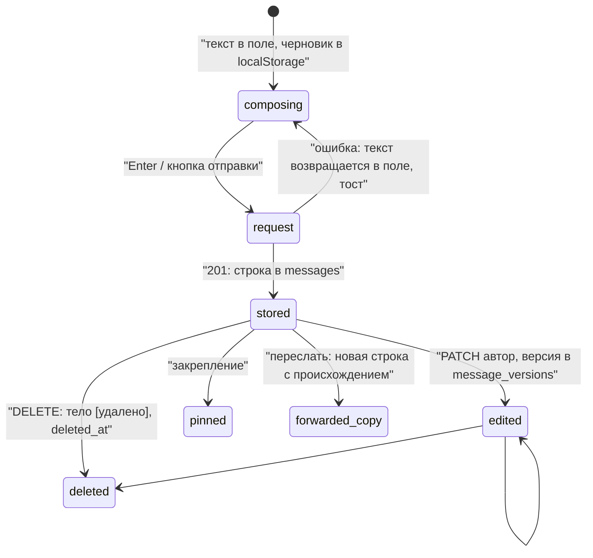
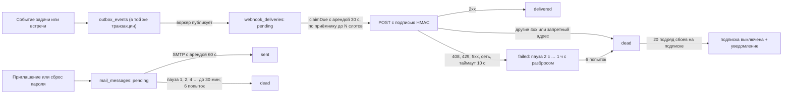

# ChatX: реальное время, права и жизненный цикл сообщения

Дата: 2026-10-15. Основа: опубликованный `main` (70 миграций, 167 файлов тестов). Пути от корня репозитория. Дополняет файл `04-interface-and-connections.md` (там реестр действий, состояния задач и заявок). Всё, что не подтверждено кодом, помечено «предложение» или «неподтверждено».

## 1. Реальное время: каналы доставки

**Транспорт: WebSocket по пути `/ws`**, библиотека `ws` (`src/server.js`, `package.json`). SSE в проекте нет (поиск по `EventSource`, `text/event-stream` в `src/` и `public/` ничего не дал). Дополнительно клиент опрашивает «внимание» (`/api/v1/attention`, `/conversations`) раз в 12 секунд, при фокусе окна и при возврате вкладки (`public/daily-work.js:252-253`), а после обрыва сокета перечитывает список бесед, задач и открытую беседу (`public/app.js connect().onopen`).

| Канал | Что несёт | Кому | Надёжность | Источник |
|---|---|---|---|---|
| WebSocket `/ws` | события `message.*`, `conversation.*`, `task.*`, `call.*`, `typing.*`, `presence.updated` и др. (полный список в `04`, раздел 6) | подключённые вкладки получателей | лучшее старание, без номеров и подтверждений | `src/realtime.js` |
| Шина между копиями | то же, через таблицу `realtime_events` и `NOTIFY chat_rt` | другие копии приложения | включается `REALTIME_BUS=true`; хранение 120 с; после обрыва догоняет за разрыв | `src/realtime.js attachBus`, `069_realtime_events.sql` |
| Web Push | уведомление при закрытой вкладке (`push`, `notificationclick`) | подписанные устройства | TTL 60 с; зависит от ключей VAPID | `src/server.js notifyUsers`, `public/sw.js` |
| Центр уведомлений | запись в `notifications` с `dedupe_key` | получатель | постоянная | `src/domain/notification.js`, `src/http/daily-work.js` |
| Опрос | счётчики внимания | клиент | каждые 12 с | `public/daily-work.js` |
| Почта | приглашение, сброс пароля, сводка | адресат | очередь с повторами | `src/mail/` |
| LiveKit | аудио, видео, экран звонка | участники звонка | отдельный сервис | `src/media/`, `public/calls-ui.js` |

### 1.1 Подключение

```mermaid
sequenceDiagram
  participant B as "Браузер"
  participant S as "Сервер /ws"
  participant DB as "PostgreSQL"
  B->>S: "Upgrade /ws + cookie chat_session"
  S->>S: "Проверка Origin: хост или PUBLIC_URL, иначе 403"
  S->>DB: "getSession по хешу токена"
  alt "нет сессии"
    S-->>B: "401, сокет закрыт"
  else "ok"
    S-->>B: "session.ready (userId, workspaceId)"
    S->>DB: "user_presence: online, если не было busy / do_not_disturb"
    S-->>B: "presence.updated остальным (кроме себя)"
  end
  loop "каждые 20 с"
    S->>DB: "перепроверка сессии"
    S-->>B: "close 4401, если сессия закончилась"
  end
  B->>B: "onclose: пауза 1,6 с × 2^n, максимум 30 с; код 4401 не переподключается"
```

Ограничения сокета: кадр до 16 КБ (`maxPayload`), не более 20 пакетов в секунду на соединение (`WS_PACKETS_PER_SECOND`), лишние молча отбрасываются с одной записью в журнал; клиент может слать только `typing.start` и `typing.stop`, остальные пакеты игнорируются. «Печатает…» гаснет через 5 секунд без обновления.

### 1.2 Рассылка сообщения

```mermaid
sequenceDiagram
  participant A as "Автор (клиент)"
  participant H as "HTTP POST /conversations/id/messages"
  participant DB as "PostgreSQL"
  participant Hub as "RealtimeHub"
  participant R as "Получатели (сокеты)"
  participant P as "Push"
  A->>H: "тело, replyToId, Idempotency-Key"
  H->>H: "Права message.send, политика беседы, объявления только для управляющих"
  H->>DB: "createMessage (уникальность client_request_id)"
  H->>Hub: "broadcastUsers(audience, message.created)"
  Hub->>R: "WebSocket JSON {event, data, at}"
  Hub->>DB: "INSERT realtime_events + NOTIFY (если шина включена)"
  H->>P: "notifyUsers: упомянутые отдельно от остальных"
  H-->>A: "201 {message}"
  Note over A,R: "Автор получает сообщение дважды (ответ и событие); append() отсекает дубль по id"
```

Что важно: событие уходит **после** записи в базу, но вне транзакции (при сбое между ними сообщение сохранено, а рассылки нет); отдельной очереди событий нет, кроме 120-секундного журнала шины. Получатели берутся по `conversationAudience` (участники), а для `message.created` push строится из `conversationNotificationAudience` (без приглушивших беседу); упомянутые уведомляются отдельно и **даже при приглушённой беседе** (`src/http/messaging.js`).

## 2. Жизненный цикл сообщения и статусы доставки

### 2.1 Что есть сейчас



Подтверждено кодом:

| Элемент | Как работает | Источник |
|---|---|---|
| Черновик | сохраняется в `localStorage` по ключу `chat:draft:<пространство>:<беседа>` | `A draftKey, writeDraft` |
| Отправка | `POST` с `Idempotency-Key`; при сетевом сбое один автоповтор с тем же ключом; при ошибке текст возвращается в поле | `A send(), api()` |
| Идентификатор запроса сообщения | сервер принимает `clientRequestId` и по уникальному индексу возвращает уже созданное сообщение; **клиент его не передаёт**, поэтому защита от дублей держится на заголовке `Idempotency-Key` | `src/http/messaging.js`, `postgres-store.js createMessage`, `A send()` |
| Правка | автор, текст, не пересланное; метка «изменено в ЧЧ:ММ», по нажатию история | `PATCH /messages/{id}`, `A msg-edited` |
| Удаление | автор либо В и А; в ленте остаётся «Сообщение удалено» | `DELETE /messages/{id}` |
| Прочтение | `POST /conversations/{id}/read` с `messageId`; граница времени самого сообщения; хранится **одна** отметка на участника: `conversation_members.last_read_at` | `postgres-store.js markRead` |
| Событие прочтения | `conversation.read {conversationId, userId, messageId}` уходит **всем** участникам беседы, но клиент использует его только для пересчёта своих бейджей | `src/http/messaging.js`, `A connect()` |
| Непрочитанное | считается на сервере, потолок 100 («99+») | `persistence/visibility.js conversationListSql` |
| Таблица квитанций | `message_receipts` создана в ранних миграциях и удалена в `034_drop_unbuilt_tables.sql` | `db/migrations/034` |

Вывод: статусов «отправляется / отправлено / доставлено / прочитано / не отправлено» **в интерфейсе нет**, подтверждено (`grep` по `public/*.js` на слова «доставлено», «прочитано» находит только разделитель непрочитанного, журнал доставок вебхуков и слова об уведомлениях). Единственные видимые состояния автора: «изменено», «удалено», закреплено, избранное.

### 2.2 Предложение: статусы сообщений

Цель: автор видит судьбу своего сообщения, не раскрывая лишнего.

| Статус | Когда наступает | Где определить | Нужна ли работа на сервере | Вид |
|---|---|---|---|---|
| Отправляется | запрос ушёл, ответа нет | клиент: между `api()` и ответом | нет | часы, `muted-2` |
| Отправлено | пришло `201` | клиент | нет | одна галочка, `muted-2` |
| Не отправлено | ошибка сети или `4xx/5xx` после автоповтора | клиент | нет; сообщение хранится в локальной очереди с тем же `clientRequestId` | восклицательный знак + «Повторить», `danger` |
| Доставлено | **предложение отложить**: без подтверждения от устройства честно вывести нельзя; допустимое упрощение: «получено сервером» = «отправлено» | нигде | нет | отдельной иконки не показывать |
| Прочитано | у другого участника `last_read_at` ≥ `createdAt` сообщения | сервер знает; клиент слышит `conversation.read` | для личных бесед: достаточно хранить в клиенте последний `messageId` от собеседника из события и при открытии получать значение с сервера (нужен безопасный `GET`, например поле в списке участников); для групп: счётчик «прочитали N», без поимённого списка | две галочки, `accent-ink` |

Правила:

1. Различать не только цветом: подпись для экранного диктора («отправляется», «отправлено», «не отправлено, повторить», «прочитано») и подсказка по долгому нажатию.
2. Показывать только автору и только для его сообщений.
3. Приватность: прочтение в группе без поимённого списка по умолчанию; решение владельца, может ли компания отключить показ прочтения (настройка рабочей области). Это юридически и этически чувствительно (трудовые отношения); решение за заказчиком.
4. Повтор неотправленного должен использовать **тот же** `clientRequestId` (клиент начнёт его передавать), чтобы не получить дубль; сервер уже умеет возвращать существующее.
5. Гостю: показывать «прочитано» только внутри его комнат; события чужих комнат до него и так не доходят.

Как проверить: тест с двумя клиентами и обрывом сети посреди отправки (одно сообщение в ленте у получателя); тест, что `conversation.read` не раскрывает читающего вне состава беседы; проверка VoiceOver/NVDA на подписи. Риск: дополнительные события увеличивают нагрузку на сокеты (каждое прочтение уходит всей беседе уже сейчас). Объём работы (оценка, допущение): клиент 2–4 дня, сервер при `GET`-эндпоинте 1–2 дня, тесты 2 дня.

## 3. Матрица прав: гость, участник, администратор, ИИ

Источники правил: `src/rbac.js` (таблица прав), `src/persistence/visibility.js` (видимость), `src/task/task-authority.js` (задачи), `src/http/messaging.js` (беседы), `src/http/helpers.js securityHeaders`. Полная матрица по 25 действиям в `04`, раздел 5. Здесь сжатая версия для сообщений, звонков и ИИ.

| Действие | Гость | Участник (member) | Руководитель | Администратор | Владелец | ИИ |
|---|---|---|---|---|---|---|
| Читать беседу | только где есть явная строка членства | открытые (`workspace`) и свои | как участник + управление | как участник + управление | всё | через пользователя, не сам |
| Писать | да (`message.send`), кроме каналов «только объявления» | да, то же | да | да | да | нет: сам не пишет |
| Править / удалять своё | да | да | да | да | да | нет |
| Удалять чужое | нет | нет | нет | да | да | нет |
| Заводить канал | нет | нет (группу от двух: да) | да | да | да | нет |
| Звонить | да (`call.start`) | да | да | да | да | нет |
| Записывать звонок | нет | нет | да | да | да | нет; запись требует согласия всех |
| Задачи | не видит | создаёт и ведёт свои | ведёт чужие | ведёт чужие | ведёт чужие | предлагает; создаёт задачу только подтверждение человека |
| Обзор беседы, варианты ответа | нет (404) | да | да | да | да | генерирует текст, не отправляет |
| Принять или отклонить предложение встречи | нет | да (`ai.use`; действие ещё `task.create`) | да | да | да | нет |

Дополнительно: ключ API работает с правами владельца ключа, режим «только чтение» блокирует любые не-GET; по ключу закрыты 2FA, сессии, смена пароля, сейф, выпуск ключей, передача владения и сброс чужих паролей (`src/server.js requireSession`).

### 3.1 Правило «ИИ только предлагает»

| Место | Как соблюдено | Источник |
|---|---|---|
| Варианты ответа | возвращает тексты; отправка остаётся кнопкой человека | `src/http/chat-assistant.js`, `A assistantSuggestModal` |
| Обзор беседы | показывает текст, ничего не меняет | `src/http/chat-assistant.js` |
| Meeting Intelligence | результат прогона получает `review_ready`; каждое предложение `proposed`; в задачу превращается только вызовом `accept` человеком (`ai.use`, а для действий и `task.create`) | `src/http/meeting-intelligence.js`, `src/meeting/meeting-repository.js` |
| Назначение ответственного | передаётся подтверждающим (`ownerId`, `acceptorId`, `promisedAt` в теле `accept`) | там же |
| База знаний «HR-бот» | отвечает только статьями без генерации | `src/knowledge/`, `docs` |
| Запись звонка | стартует только по согласию каждого активного участника | `src/http/calls.js` |
| Стоимость | версионные тарифы, лимиты и повторы под правами `meeting.ops.manage` / `meeting.cost.*` | `src/http/meeting-operations.js` |

Что не подтверждено: нет теста, который падает, если кто-то добавит ИИ-путь, создающий задачу или сообщение без вызова человека (есть сквозные тесты процесса, но «запрещающего» нет); стоит добавить.

## 4. Идемпотентность и версии

| Механизм | Где | Как работает | Источник |
|---|---|---|---|
| `Idempotency-Key` | все `POST/PATCH/PUT/DELETE` под `/api/` при наличии заголовка | ключ + метод + путь + тело = отпечаток; повтор того же даёт сохранённый ответ с заголовком `idempotent-replay: true`; тот же ключ с другим телом `409 IDEMPOTENCY_KEY_REUSED`; пока первый идёт, `409 IDEMPOTENCY_IN_PROGRESS`; ответ 5xx не сохраняется (ключ освобождается); срок 24 часа | `src/http/idempotency.js`, `src/server.js` |
| Исключение | запросы тяжелее 1 МБ JSON (загрузка файла) ключом не защищены | `src/server.js` (`oversized`) | |
| Клиент | `A api()` ставит ключ на каждую запись автоматически; `requests.js`, `calls-ui.js` ставят свой; `daily-work.js`, загрузка файла и голос ключа **не ставят** | `public/*.js` | |
| `expectedVersion` | обязателен для переходов задачи, доказательств, переноса срока, передачи; для вики; для правки беседы | `409 STALE_TASK_ACTION` / `TASK_VERSION_REQUIRED` | `src/task/task-authority.js`, `src/wiki/wiki-repository.js`, `src/http/messaging.js` |
| Не защищено версией | заявки (`requests.version` растёт, но клиент её не шлёт: защита статусом шага и блокировкой строки); сообщения (правка без версии: последний выигрывает) | `src/requests/request-repository.js` | |
| Дубли уведомлений | `UNIQUE (workspace, dedupe_key)` | `notifications` | |
| Дубли писем | уникальный индекс «вид письма + порождающее событие» | `ARCHITECTURE.md`, `mail_messages` | |

## 5. Очереди



| Очередь | Гарантия | Параметры по умолчанию (env) | Что наблюдать |
|---|---|---|---|
| Вебхуки | «хотя бы один раз»; повтор может дать двойную доставку (`x-chat-event-id` для дедупликации у получателя) | опрос 2 с, пачка 10, таймаут 10 с, аренда 30 с, на одного приёмника `ceil(10/4)=3` слота, без редиректов, адрес проверяется перед каждой отправкой | `chat_queue_pending`, `chat_queue_failed`, `chat_queue_oldest_seconds{queue="webhooks"}` |
| Почта | аренда; при потере аренды письмо уходит повторно (приглашение может продублироваться) | опрос 5 с, пачка 5, аренда 60 с | то же с `queue="mail"`; без `MAIL_HOST` канал выключен |
| Встречи (Meeting) | отдельный воркер, `max_attempts` 5, статусы `pending, processing, succeeded, failed, dead_letter, cancelled`, ручной повтор с причиной | `MEETING_WORKER_*` | `/api/v1/admin/meeting-jobs`, расходы |
| Напоминания | `FOR UPDATE SKIP LOCKED`, смена состояния и уведомление в одной транзакции | | воркер напоминаний |
| Реальное время | `realtime_events` хранится 120 с | `REALTIME_BUS` | счётчик ошибок шины |
| Сводки | рассылка рядом с почтой | | `digestMailer` |

Практический риск (из `AGENTS-SNIPPET.md`): дев-сервер на той же базе забирает очереди; тестовая база должна быть отдельной.

## 6. PWA и офлайн

`public/sw.js` (кэш `chat-shell-v27`), `public/manifest.webmanifest`.

| Что | Как | Оценка |
|---|---|---|
| Стратегия | «сначала сеть, кэш на случай отказа» для GET своего origin; маршруты `/api/` не трогаются | хорошо: не кэширует чужие данные |
| Предкэш (`SHELL`) | 20 путей: страница, 5 css, 7 js, манифест, значки | нет `shared-bootstrap.js`, `theme-boot.js`, `vendor/livekit-client.js` |
| Кладёт в кэш только `response.ok && type==='basic'` | защищает от «навсегда 404» | хорошо |
| Навигация без сети | отдаёт закэшированную `/` | оболочка открывается, но данных нет: `offlineScreen()` и тост «Нет связи» |
| Отправка без сети | не ставится в очередь, текст возвращается в поле, черновик в `localStorage` | офлайн-режима записи нет (подтверждено) |
| Push | показывает уведомление, шлёт `postMessage` окнам (входящий звонок), по клику открывает `url` | работает при ключах VAPID |
| Манифест | `display: standalone`, фон и тема `#050505`, значки 192/512 PNG + SVG, три ярлыка (Сообщения, Задачи, Календарь) | значок `maskable` использует тот же 512 без запаса полей (проверить визуально) |
| Версия кэша | меняется вручную (`v27`) | риск забыть при выпуске; нет теста |
| Обновление | `skipWaiting` + `clients.claim` | страница может получить новую оболочку при старом JS в памяти до перезагрузки |

## 7. OpenAPI и маршруты

`src/openapi.js`: OpenAPI 3.1.0, версия документа `0.11.0` (в `package.json` `0.4.0`, расхождение номеров), 176 путей, 228 операций, 20 тегов, схемы безопасности: cookie `chat_session` и Bearer-ключ. Публикуется по `GET /openapi.json` и `/api/v1/openapi`, без авторизации. Проверка соответствия: `test/openapi-sync.test.js` сверяет только **первый сегмент** пути; поэтому описанные в `04` (раздел 8, пункты 1–2) расхождения проходят. Предложение: проверять операции целиком (метод + путь с заменой параметров).

Структура кода маршрутов: цепочка `handleXxx` в `src/server.js` (порядок важен: более узкие шаблоны стоят раньше, например `catalogue` и `versions` до `{id}`), 30 файлов `src/http/*.js`; ответы об ошибках приводятся к русскому тексту (`src/http/ru-errors.js`, `public/preferences.js`).

## 8. Нагрузка и ограничения

| Параметр | Значение | Источник |
|---|---|---|
| Лимит вошедшего человека | обычные GET 600 в минуту, запись 180, поиск/сводка/отчёт 60, выгрузка пространства 3 | `src/rate-limit.js createApiThrottle` |
| Вход | 20 на адрес и 6 на почту за 15 минут | `createAuthThrottle` |
| Область счётчиков | память процесса, на каждую копию отдельно | комментарий в `rate-limit.js`, `.env.example` |
| Тело JSON | 1 000 000 байт | `src/http/helpers.js MAX_JSON` |
| Файл | 50 МБ, читается целиком в память (`readBuffer`); в домене заявлено до 2 ГБ, разное | `MAX_FILE`, `src/domain/media.js` |
| Сообщение | до 12 000 знаков, метаданные до 16 КБ | `src/http/messaging.js` |
| Страница сообщений | 100 по умолчанию, не более 200 | `pageSize(..., 100, 200)` |
| Пул PostgreSQL | 10 соединений, таймаут запроса 15 с, блокировки 5 с, подключение 3 с | `src/server.js defaultStore` |
| Сокеты | 16 КБ кадр, 20 пакетов/с; число подключений в метрике `chat_websocket_connections` | `src/server.js`, `src/obs/metrics.js` |
| Статика | gzip, кэш 64 файла; `app.js` 527 КБ, `preferences.js` 262 КБ, `styles.css` 78 КБ; `Cache-Control: no-cache` + ETag | `src/server.js` |
| Лента | `content-visibility:auto` для сообщений | `public/styles.css` |
| Несколько копий | возможны при `REALTIME_BUS=true`; лимиты запросов не общие; воркеры очередей на каждой копии (аренда защищает от двойной работы) | `.env.example`, `src/realtime.js` |
| Хранение | `RETENTION_DAYS` 90 и 30 для уведомлений; журнал и работа не чистятся | `src/maintenance/retention.js` |
| Нагрузочные тесты | в `test/` нет файлов с «load», «perf», «stress»; цифр пропускной способности нет | `ls test` |

Оценка (допущение, не измерение): один процесс Node с пулом 10 и записью каждого сообщения в PostgreSQL, рассылкой по сокетам и по шине способен на сотни одновременных вкладок; границу покажет только замер. Рекомендация: до пилота снять профиль на 200 соединениях и 20 сообщений в секунду, зафиксировать метрики `chat_http_request_seconds` и `chat_db_pool_waiting`.

## 9. Что осталось неподтверждённым

- Поведение под нагрузкой, потери событий при разрыве сокета в середине рассылки, повторное получение после реконнекта (клиент просто перечитывает списки).
- Работа Push, LiveKit и SMTP на реальных ключах.
- Реальный размер `readBuffer` для 50 МБ на малой памяти контейнера.
- Корректность `maskable`-значка и поведение установленного PWA на iOS.
- Нужен ли заказчику показ прочтения (юридическая сторона).
- Что делает `conversationAudience` для гостей при смене состава в момент рассылки (гонка не проверялась).

## Расхождения с пакетом 01–03

См. таблицу в конце `04-interface-and-connections.md`. Дополнительно для этого файла: в `01` сказано «read cursor есть на сервере» (подтверждено: `conversation_members.last_read_at`), «в UI не найдено статусов» (подтверждено; раздел 2).
